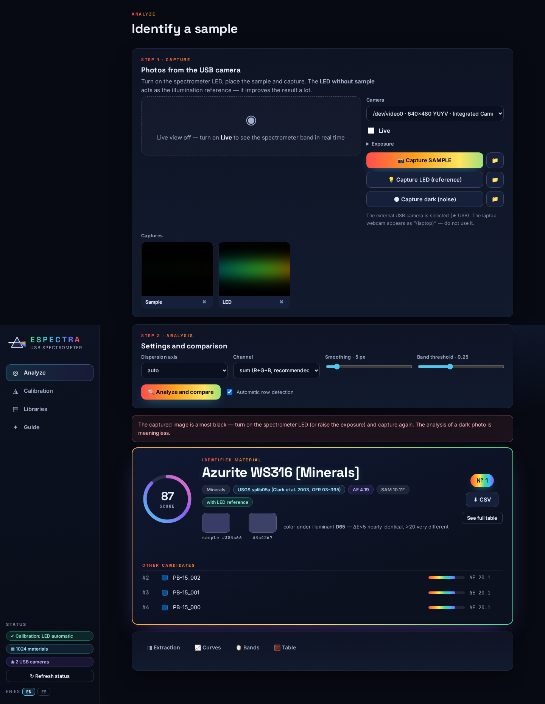
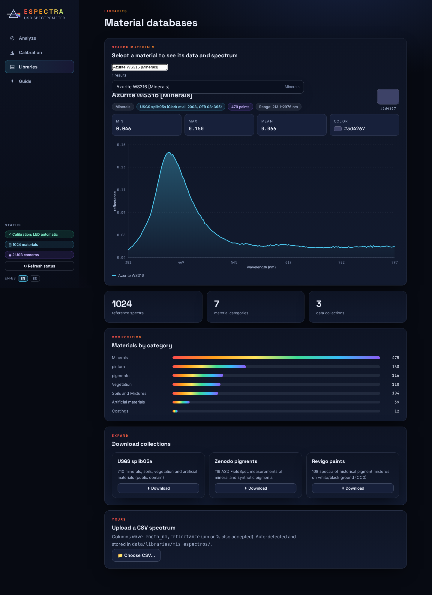
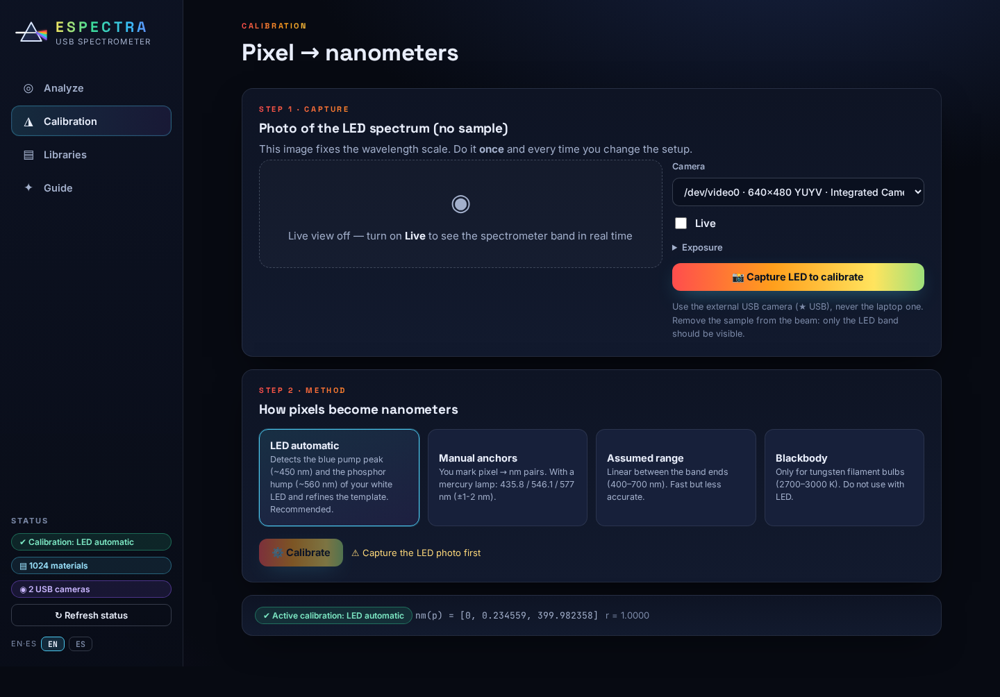
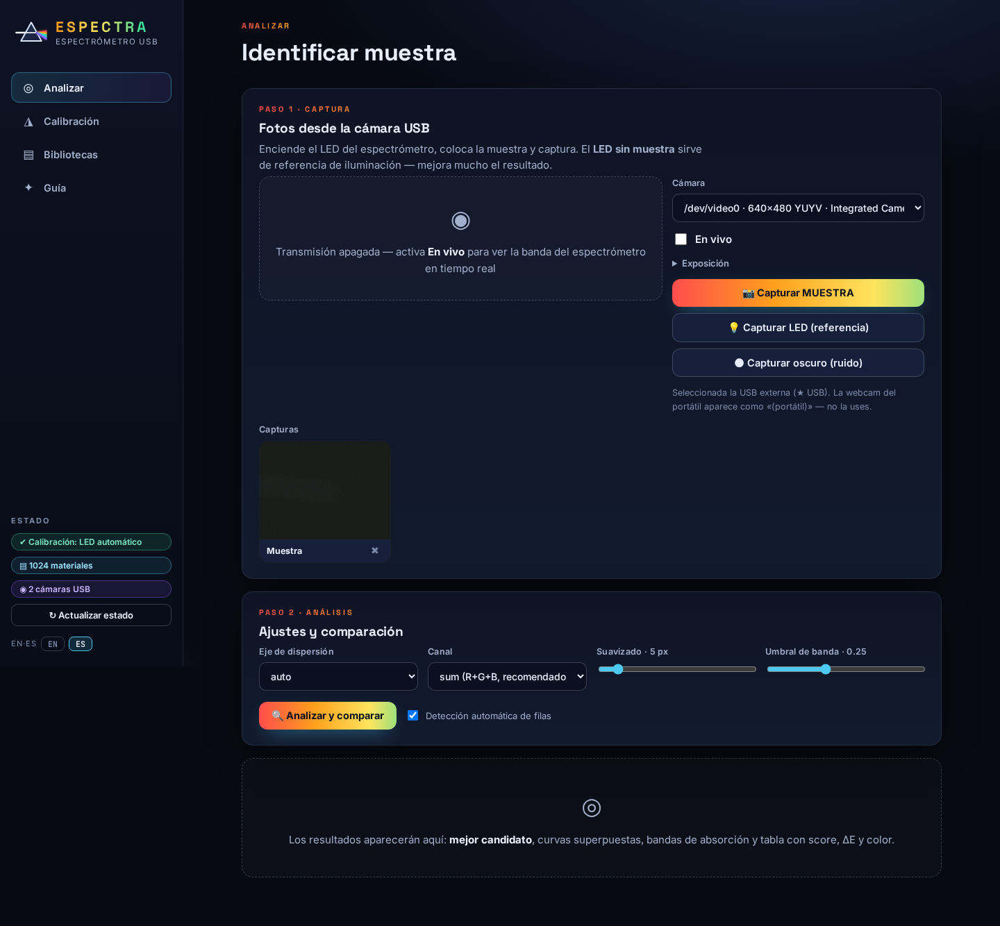

# ESPECTRA · Espectrómetro USB

[](https://github.com/VABISMO/espectra/actions/workflows/ci.yml)
[](LICENSE)
[](pyproject.toml)
[](frontend/)
[](data/libraries/)

**Convierte una cámara USB + tubo dispersor en un espectrómetro web que
identifica materiales.** Vista en vivo → calibración automática con LED
blanco (píxel → nm) → pseudo-reflectancia → comparación contra **1.024
espectros de referencia** con ángulo espectral, bandas de absorción y
**color CIELAB (ΔE)**.

> 🇬🇧 English version: [README.md](README.md)

<p align="center">
  
</p>

## Características

- 📷 **Captura en vivo por USB** (V4L2/OpenCV) — prioriza siempre la cámara
  USB externa y nunca la integrada del portátil
- 🌈 **Calibración con LED blanco** — detecta la bomba azul InGaN (~450 nm)
  y el hump del fósforo (~560 nm), refina contra una plantilla (error < 1 nm
  en pruebas); también anclas manuales, rango asumido y cuerpo negro
- 🎯 **Identificación de materiales** —
  `score = 0.35·cos(SAM) + 0.40·bandas + 0.25·color(ΔE)` sobre rejilla
  400–700 nm
- 🎨 **Ciencia del color incluida** — observador CIE 1931 + iluminante D65
  empaquetados; muestras de color de la muestra y del candidato lado a lado
- 🔍 **Biblioteca con buscador** — autocompletado sobre 1.024 materiales con
  ficha: gráfica del espectro, mín/máx/media, rango y color
- 🌍 **Inglés (default) y español** — selector discreto, persistido
- 🖥️ **Interfaz React** (tema oscuro, centrado) servida por backend FastAPI
- 🧪 **31 tests end-to-end** + CI en GitHub Actions

<p align="center">
  
  &nbsp;
  
  &nbsp;
  
</p>

## Requisitos

- **Linux con V4L2** para la captura en vivo (el análisis, la calibración y
  la CLI también funcionan en macOS/Windows — solo la captura en vivo es
  exclusiva de Linux)
- Python **3.10+** · Node.js **18+** (compilación del frontend)
- Cualquier **cámara USB UVC** + tubo de espectrómetro o red de difracción
- Opcional: lámpara de mercurio para anclas de calibración de ±1-2 nm

## Arranque rápido

```bash
git clone https://github.com/VABISMO/espectra.git
cd espectra
./install.sh            # venv + dependencias + compilación de la interfaz
.venv/bin/python server.py
# → http://localhost:8000
```

Manual (o `make install` / `make run`):

```bash
python3 -m venv .venv && .venv/bin/pip install -r requirements.txt
cd frontend && npm install && npm run build && cd ..
.venv/bin/python server.py
```

Verifica todo el pipeline:

```bash
.venv/bin/python -m espectro demo     # análisis sintético → PASS
.venv/bin/python tests/run_tests.py   # 31 comprobaciones: motor + API + cámara
```

## Cómo funciona

```
cámara USB ──► vista en vivo MJPEG ──► captura MUESTRA / LED / oscuro
                                              │
       calibración con LED blanco             ▼           biblioteca (1024)
       pico azul 450 nm + fósforo 560 nm ──► nm ──► muestra ÷ LED ──► match
       + refinado de plantilla (r ≈ 1.000)        pseudo-reflectancia   │
                                                          SAM + bandas + ΔE
                                                                  ▼
                                              mejor candidato + top-3 + CSV
```

1. **Extracción** — detecta el eje de dispersión, promedia la banda encendida,
   resta la foto oscura (canal `R+G+B`, respuesta plana).
2. **Calibración** — polinomio `nm = P(píxel)`; el modo LED ajusta offset,
   escala y curvatura contra `LED(λ)·QE(λ)` por correlación.
3. **Pseudo-reflectancia** — `muestra ÷ LED` cancela lámpara, óptica y sensor.
   Conserva la forma espectral; no es reflectancia absoluta.
4. **Comparación** — ángulo espectral (SAM), bandas sin continuo y color
   CIELAB ΔE bajo D65, ponderados `0.35 / 0.40 / 0.25`.

## Selección de cámara

Los dispositivos se identifican por sysfs (`/sys/class/video4linux/*/name`):

| Dispositivo | Nombre | Por defecto |
|---|---|---|
| `/dev/video4` | `USB2.0 UVC PC Camera` | ✅ seleccionada (★ USB) |
| `/dev/video0/2` | `Integrated Camera` | ❌ marcada *(portátil)* |

La sonda usa TTL de 20 s, deduplica nodos de metadatos y lista las ocupadas
como `openable: false` — la cámara del espectrómetro nunca se pierde.

## Bibliotecas de referencia (1.024 espectros)

| Colección | Nº | Origen / licencia |
|---|---|---|
| USGS splib05a | 740 | Clark et al. 2003, OFR 03-395 — dominio público |
| Pigmentos Zenodo | 116 | Carrino et al. 2025, DOI [10.5281/zenodo.14906872](https://doi.org/10.5281/zenodo.14906872) |
| Pinturas Revigo | 168 | [fligt/revigo-spectra](https://github.com/fligt/revigo-spectra) — CC0 |

```bash
.venv/bin/python scripts/fetch_usgs.py       # actualizar USGS
.venv/bin/python scripts/fetch_pigments.py   # actualizar pigmentos
.venv/bin/python scripts/fetch_revigo.py     # actualizar pinturas
.venv/bin/python scripts/fetch_color_data.py # CIE 1931 + D65 (incluidos)
```

Añade los tuyos: cualquier CSV `wavelength_nm,reflectance` en
`data/libraries/` (µm y % se auto-detectan) o súbelo desde la pantalla
**Bibliotecas**. Los `.spectrum.txt` de ECOSTRESS se leen directamente.

## Línea de comandos

```bash
python -m espectro calibrate led.png                 # calibración LED auto
python -m espectro calibrate led.png --anchor 213 450 --anchor 682 560
python -m espectro extract muestra.png -o muestra.csv
python -m espectro match muestra.csv --lamp led.csv \
        --cal data/calibration/cal.json --top 5
python -m espectro info
```

## API

| Método | Endpoint | Función |
|---|---|---|
| GET | `/api/status?refresh_cameras=true` | calibración, cámaras (fuerza re-sondeo), biblioteca |
| GET | `/api/stream` | vista en vivo MJPEG |
| POST | `/api/capture/{slot}` | capturar `sample`/`lamp`/`dark`/`cal` |
| GET/DELETE | `/api/frame/{slot}` | foto capturada / borrarla |
| POST | `/api/analyze` | identificación completa → JSON |
| POST | `/api/calibrate` | píxel → nm (led/anclas/rango/cuerpo negro) |
| GET | `/api/calibration/preview` | gráfica de calibración (PNG) |
| GET | `/api/library/search?q=` | autocompletado |
| GET | `/api/library/spectrum?name=` | ficha + datos de la gráfica |
| POST | `/api/library/fetch/{usgs\|pigments\|revigo}` | descargar colecciones |
| POST | `/api/library/upload` | subir CSV propio |
| POST | `/api/camera/{settings,refresh,stop}` | índice de cámara / exposición |

Todos los mensajes aceptan `lang=en|es`.

## Solución de problemas

| Síntoma | Solución |
|---|---|
| La imagen sale casi negra | Enciende el LED del espectrómetro (o sube **Exposición**); la app te avisa |
| Falta la cámara USB en el selector | Conéctala → **Refresh status** (el sondeo caduca a los 20 s) |
| Se eligió la cámara del portátil | Elige la entrada `★ USB` en el desplegable **Camera** |
| Los resultados parecen aleatorios | Recalibra con **LED automático**, usa la foto del LED como referencia y misma exposición en muestra y LED |
| «Calibration only covers N points» | La calibración no cubre tu banda — captura el LED de nuevo |
| No se detecta la banda | Ajusta *Band threshold* / *Smoothing* o fija las filas a mano |

## Estructura

```
server.py            API FastAPI + estáticos (puerto 8000)
espectro/            motor: camara · image · calib · color · reflectance
                     · library · match · plotting · cli
espectro/data/       CMF CIE 1931 + iluminante D65
frontend/            React + Vite (src/pages, src/components, i18n.js)
scripts/             descargadores de bibliotecas
data/libraries/      1.024 espectros de referencia (CSV)
tests/run_tests.py   suite end-to-end (Python puro, sin pytest)
.github/workflows/   CI: lint + demo + tests + build del frontend
```

## Límites honestos

- Solo el visible (**400–700 nm**): hay materiales indistinguibles
  (calcita vs cuarzo); el infrarrojo requiere otro hardware.
- La pseudo-reflectancia identifica **familias** de materiales, no
  composiciones cuantitativas.
- Calibración LED automática ≈ **±5-10 nm**; con lámpara de mercurio y
  anclas (`--anchor px 435.8 …`) ≈ ±1-2 nm.
- Cámaras de 8 bits con gamma/compresión: dispara sin saturar, misma
  exposición en muestra y LED, PNG sobre JPEG.

## Contribuir

Ver [CONTRIBUTING.md](CONTRIBUTING.md). Los textos de la interfaz están en
`frontend/src/i18n.js` (**añade cada clave a `en` y `es`**); los mensajes del
backend usan `_m(lang, es, en)`.

## Licencia

Código: [MIT](LICENSE). Datos: USGS (dominio público), Revigo (CC0),
pigmentos Zenodo (ver DOI). Cita las fuentes de datos al publicar resultados.

## Referencias

- Kokaly, R.F. et al. (2017). *USGS Spectral Library Version 7.* USGS DS 1035.
- Clark, R.N. et al. (2003). *USGS Digital Spectral Library splib05a.* OFR 03-395.
- Carrino, T.A. et al. (2025). Zenodo, DOI 10.5281/zenodo.14906872.
- Meerdink, S.K. et al. (2019). *ECOSTRESS spectral library v1.0.*
  Rem. Sens. Environ. 230, 111196.
- Funciones de igualación CIE 1931 e iluminante D65 vía colour-science.
