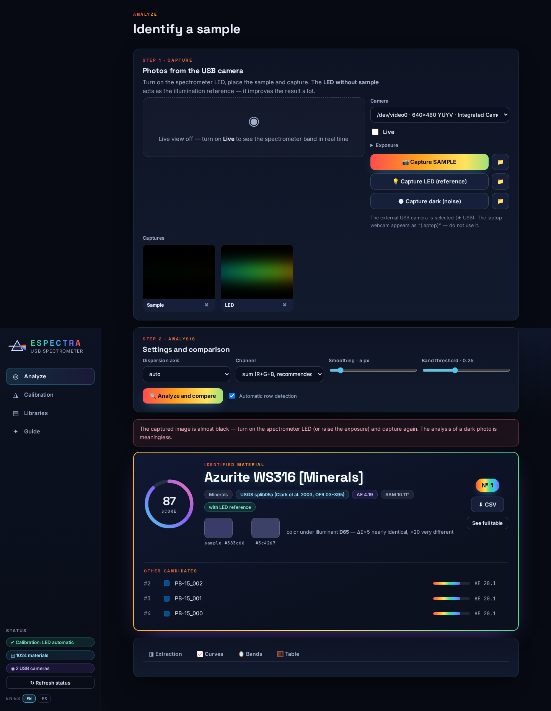
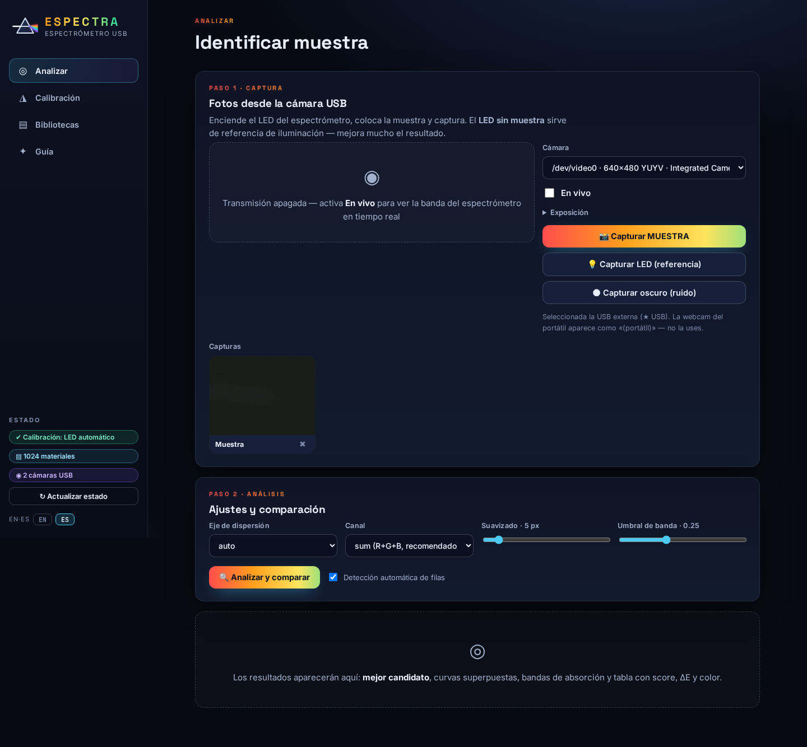

# ESPECTRA · USB Spectrometer

[](https://github.com/VABISMO/espectra/actions/workflows/ci.yml)
[](LICENSE)
[](pyproject.toml)
[](frontend/)
[](data/libraries/)

**Turn a USB camera + diffraction tube into a web spectrometer that identifies
materials.** Live camera view → automatic white-LED calibration (pixel → nm) →
pseudo-reflectance → matching against **1,024 reference spectra** using
spectral angle, absorption bands and **CIELAB color (ΔE)**.

<p align="center">
  
</p>

## Features

- 📷 **Live USB camera capture** (V4L2/OpenCV) — automatically prefers the
  external USB camera and never the laptop's built-in webcam
- 🌈 **White-LED calibration** — detects the InGaN blue pump (~450 nm) and
  phosphor hump (~560 nm), refines against an LED template (error < 1 nm in
  tests); manual anchors / assumed range / blackbody modes also available
- 🎯 **Material identification** — `score = 0.35·cos(SAM) + 0.40·band
  continuity + 0.25·color(ΔE)` over a 400–700 nm grid
- 🎨 **Color science included** — CIE 1931 observer + D65 illuminant bundled;
  sample and candidate swatches shown side by side
- 🔍 **Searchable library** — autocomplete over 1,024 materials with a detail
  card: spectrum chart, min/max/mean, range, color chip
- 🌍 **English (default) & Spanish** — one discreet selector, persisted
- 🖥️ **React UI** (dark theme, centered layout) served by a FastAPI backend
- 🧪 **31 end-to-end tests** + GitHub Actions CI

<p align="center">
  
  &nbsp;
  
  &nbsp;
  
</p>

## Requirements

- **Linux with V4L2** for live camera capture (the analysis/calibration/CLI
  also run on macOS/Windows — only live capture is Linux-only)
- Python **3.10+** · Node.js **18+** (frontend build)
- Any **UVC USB camera** + diffraction tube or grating spectrometer
- Optional: mercury lamp for ±1–2 nm calibration anchors

## Quick start

```bash
git clone https://github.com/VABISMO/espectra.git
cd espectra
./install.sh            # venv + Python deps + frontend build
.venv/bin/python server.py
# → http://localhost:8000
```

Manual (or `make install` / `make run`):

```bash
python3 -m venv .venv && .venv/bin/pip install -r requirements.txt
cd frontend && npm install && npm run build && cd ..
.venv/bin/python server.py
```

Verify the whole pipeline:

```bash
.venv/bin/python -m espectro demo     # synthetic end-to-end → PASS
.venv/bin/python tests/run_tests.py   # 31 checks: engine + API + camera
```

## How it works

```
USB camera ──► live MJPEG view ──► capture SAMPLE / LED / dark
                                          │
     white-LED calibration                ▼          library (1024)
     blue peak 450 nm + phosphor 560 nm ──► nm ──► sample ÷ LED ──► matching
     + template refinement (r ≈ 1.000)         pseudo-reflectance   │
                                                          SAM + bands + ΔE color
                                                                  ▼
                                                    best candidate + top-3 + CSV
```

1. **Extraction** — detects the dispersion axis, averages the bright band,
   subtracts the dark frame (channel `R+G+B`, flat response across colors).
2. **Calibration** — polynomial `nm = P(pixel)`; the LED mode fits offset,
   scale and curvature against a `LED(λ)·QE(λ)` template by correlation.
3. **Pseudo-reflectance** — `sample ÷ LED` cancels lamp, optics and sensor.
   It preserves spectral shape; it is *not* absolute reflectance.
4. **Matching** — spectral angle (SAM), continuum-removed absorption bands
   and CIELAB ΔE under D65, weighted `0.35 / 0.40 / 0.25` with a band-depth
   penalty.

## Camera selection

Devices are identified via sysfs (`/sys/class/video4linux/*/name`):

| Device | Name | Default |
|---|---|---|
| `/dev/video4` | `USB2.0 UVC PC Camera` | ✅ selected (★ USB) |
| `/dev/video0/2` | `Integrated Camera` | ❌ marked *(laptop)* |

The probe uses a 20 s TTL, deduplicates metadata nodes and lists busy devices
as `openable: false` so the spectrometer camera is never lost.

## Reference libraries (1,024 spectra)

| Collection | N | Source / license |
|---|---|---|
| USGS splib05a | 740 | Clark et al. 2003, OFR 03-395 — public domain |
| Zenodo pigments | 116 | Carrino et al. 2025, DOI [10.5281/zenodo.14906872](https://doi.org/10.5281/zenodo.14906872) |
| Revigo paints | 168 | [fligt/revigo-spectra](https://github.com/fligt/revigo-spectra) — CC0 |

```bash
.venv/bin/python scripts/fetch_usgs.py       # refresh USGS
.venv/bin/python scripts/fetch_pigments.py   # refresh pigments
.venv/bin/python scripts/fetch_revigo.py     # refresh paints
.venv/bin/python scripts/fetch_color_data.py # CIE 1931 + D65 (bundled)
```

Add your own: drop any `wavelength_nm,reflectance` CSV in
`data/libraries/` (µm and % auto-detected) — or upload it from the
**Libraries** screen. ECOSTRESS `.spectrum.txt` files are parsed natively.

## CLI

```bash
python -m espectro calibrate led.png                 # LED auto-calibration
python -m espectro calibrate led.png --anchor 213 450 --anchor 682 560
python -m espectro extract sample.png -o sample.csv
python -m espectro match sample.csv --lamp led.csv \
        --cal data/calibration/cal.json --top 5
python -m espectro info
```

## API

| Method | Endpoint | Purpose |
|---|---|---|
| GET | `/api/status?refresh_cameras=true` | calibration, cameras (force re-probe), library stats |
| GET | `/api/stream` | live MJPEG view |
| POST | `/api/capture/{slot}` | capture `sample`/`lamp`/`dark`/`cal` |
| GET/DELETE | `/api/frame/{slot}` | captured photo / clear it |
| POST | `/api/analyze` | full identification → JSON (curves, top-10, colors) |
| POST | `/api/calibrate` | pixel → nm (led/anchors/range/blackbody) |
| GET | `/api/calibration/preview` | calibration plot (PNG) |
| GET | `/api/library/search?q=` | autocomplete |
| GET | `/api/library/spectrum?name=` | material detail + chart data |
| POST | `/api/library/fetch/{usgs\|pigments\|revigo}` | download collections |
| POST | `/api/library/upload` | add your own CSV |
| POST | `/api/camera/{settings,refresh,stop}` | camera index / exposure control |

All messages accept `lang=en|es`.

## Troubleshooting

| Symptom | Fix |
|---|---|
| Frame is almost black | Turn on the spectrometer LED (or raise **Exposure**); the app warns you |
| USB camera missing from the selector | Plug it in → **Refresh status** (probe TTL is 20 s) |
| Wrong (laptop) camera selected | Pick the `★ USB` entry in the **Camera** dropdown |
| Results look random | Recalibrate with **LED automatic**, use the LED reference photo, same exposure for sample and LED |
| "Calibration only covers N points" | The calibration doesn't span your band — capture the LED again |
| Band not detected | Adjust *Band threshold* / *Smoothing*, or set the rows manually |

## Project structure

```
server.py            FastAPI API + static host (port 8000)
espectro/            engine: camara · image · calib · color · reflectance
                     · library · match · plotting · cli
espectro/data/       CIE 1931 CMFs + D65 illuminant
frontend/            React + Vite (src/pages, src/components, i18n.js)
scripts/             library fetchers
data/libraries/      1,024 reference spectra (CSV)
tests/run_tests.py   end-to-end suite (plain Python, no pytest)
.github/workflows/   CI: lint + demo + tests + frontend build
```

## Limits (honest)

- Visible range only (**400–700 nm**) — some materials are indistinguishable
  (calcite vs quartz); infrared needs different hardware.
- Pseudo-reflectance identifies **families** of materials, not quantitative
  compositions.
- Automatic LED calibration ≈ **±5–10 nm**; with a mercury lamp and anchors
  (`--anchor px 435.8 …`) ≈ ±1–2 nm.
- 8-bit cameras add gamma/compression — shoot unsaturated, same exposure for
  sample and LED, prefer PNG over JPEG.

## Contributing

See [CONTRIBUTING.md](CONTRIBUTING.md). UI strings live in
`frontend/src/i18n.js` (**add every key to both `en` and `es`**); backend
messages use `_m(lang, es, en)`.

## License

Code: [MIT](LICENSE). Data: USGS (public domain), Revigo (CC0), Zenodo
pigments (see DOI). Please cite the data sources when publishing results.

## References

- Kokaly, R.F. et al. (2017). *USGS Spectral Library Version 7.* USGS DS 1035.
- Clark, R.N. et al. (2003). *USGS Digital Spectral Library splib05a.* OFR 03-395.
- Carrino, T.A. et al. (2025). Zenodo, DOI 10.5281/zenodo.14906872.
- Meerdink, S.K. et al. (2019). *ECOSTRESS spectral library v1.0.*
  Rem. Sens. Environ. 230, 111196.
- CIE 1931 color matching functions & D65 via colour-science (CIE data).
