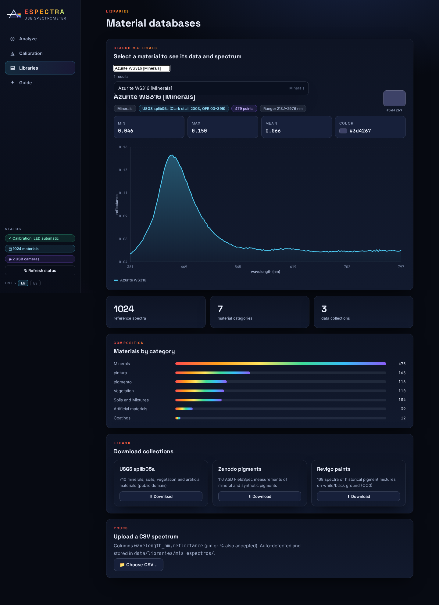
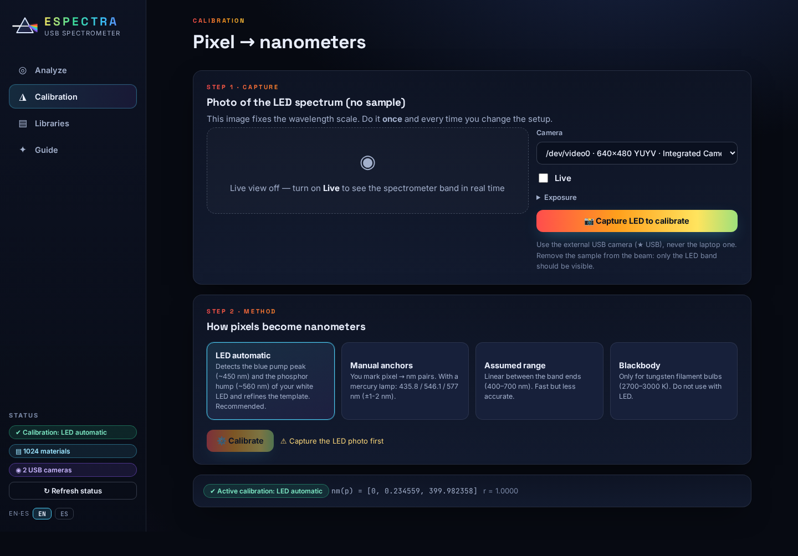

# ESPECTRA · USB Spectrometer

[](https://github.com/VABISMO/espectra/actions/workflows/ci.yml)
[](LICENSE)
[](pyproject.toml)
[](frontend/)
[](data/libraries/)

**Turn a USB camera + diffraction tube into a web spectrometer that identifies
materials.** Live camera view → automatic white-LED calibration (pixel → nm) →
pseudo-reflectance → matching against **1,024 reference spectra** using
spectral angle, absorption bands and **CIELAB color (ΔE)**.

<p align="center">
  
</p>

## Features

- 📷 **Live USB camera capture** (V4L2/OpenCV) — automatically prefers the
  external USB camera and never the laptop's built-in webcam
- ⚡ **Mercury/CFL line calibration** — fits the narrow Hg lines
  (404.7 / 435.8 / 546.1 / 577–579 nm): they are sharp, so they pin down
  both the position **and the curvature** (**±1–2 nm**). Tried first by
  default; the white-LED mode (blue pump ~450 nm + phosphor hump ~560 nm)
  is the automatic fallback and only yields an **affine** fit
  (**±5–10 nm** — a broad smooth spectrum cannot constrain curvature,
  self-consistency < 5 nm on synthetic data). Manual anchors / assumed
  range / blackbody also available
- 🛑 **"Unknown" class** — every result carries a verdict
  (`identified` / `uncertain` / `unknown`) built from a score threshold
  and a margin between families. When nothing reaches them the API says
  so instead of dressing up the top candidate as an answer
- 🎚 **References matched to your resolution** — every library spectrum is
  convolved to the instrument line shape (`--fwhm`, default 7 nm) before
  comparison, so a high-resolution USGS curve is not rewarded for being
  sharper than your tube can ever be
- 🫥 **Honest output** — points where the lamp is too weak (LED red tail
  above ~680 nm, blue-green valley) are *masked out*, never zero-filled,
  and every metric is evaluated only on the valid points
- 📐 **Optional gamma linearization** — `gamma=2.2` undoes the camera's
  8-bit gamma *before* dividing sample ÷ LED, so absorption bands are not
  compressed (`--gamma`, `POST /api/analyze {"gamma": ...}`)
- 🎯 **Material identification** — `score = 0.20·cos(SAM) + 0.10·band
  continuity + 0.70·color(ΔE)` over a 400–700 nm grid; the weights come
  from `benchmark.py --sweep-weights`, not from taste
- 🎨 **Color science included** — CIE 1931 observer + D65 illuminant bundled;
  sample and candidate swatches shown side by side
- 🔍 **Searchable library** — autocomplete over 1,024 materials with a detail
  card: spectrum chart, min/max/mean, range, color chip
- 🌍 **English (default) & Spanish** — one discreet selector, persisted
- 🖥️ **React UI** (dark theme, centered layout) served by a FastAPI backend
- 🧪 **71 end-to-end tests** + a **leave-one-out benchmark** with real
  top-1 / top-3 rates + GitHub Actions CI

<p align="center">
  
  &nbsp;
  
  &nbsp;
  
</p>

## Requirements

- **Linux with V4L2** for live camera capture (the analysis/calibration/CLI
  also run on macOS/Windows — only live capture is Linux-only)
- Python **3.10+** · Node.js **18+** (frontend build)
- Any **UVC USB camera** + diffraction tube or grating spectrometer
- **Recommended for accuracy:** a mercury or compact fluorescent (CFL) lamp —
  its narrow lines at **435.8 and 546.1 nm** are far better calibration
  anchors than a white LED (±1–2 nm vs ±5–10 nm)

## Quick start

```bash
git clone https://github.com/VABISMO/espectra.git
cd espectra
./install.sh            # venv + Python deps + frontend build
.venv/bin/python server.py
# → http://localhost:8000
```

Manual (or `make install` / `make run`):

```bash
python3 -m venv .venv && .venv/bin/pip install -r requirements.txt
cd frontend && npm install && npm run build && cd ..
.venv/bin/python server.py
```

Verify the whole pipeline:

```bash
.venv/bin/python -m espectro demo     # synthetic end-to-end → PASS
.venv/bin/python tests/run_tests.py   # 71 checks: engine + API + camera
.venv/bin/python scripts/benchmark.py # leave-one-out: top-1 / top-3 rates
```

## How it works

```
USB camera ──► live MJPEG view ──► capture SAMPLE / LED / dark
                                          │
  calibration                            ▼            library (1024)
  Hg lines 404.7/435.8/546.1 ──► nm ──► sample ÷ LED ──► refs convolved
  (±1-2 nm, con curvatura)          pseudo-reflectance    to 7 nm FWHM
  else LED 450+560 (±5-10 nm)              │                    │
  + template refinement (r ≈ 1.000)         └──────┬─────────────┘
                                                   ▼
                                  SAM + bands + ΔE color, on valid
                                  points only (lamp-weak → NaN)
                                                   ▼
                                best candidate + verdict + top-3 + CSV
```

1. **Extraction** — detects the dispersion axis, averages the bright band,
   subtracts the dark frame (channel `R+G+B`, flat response across colors).
2. **Calibration** — polynomial `nm = P(pixel)`. The default mode tries the
   narrow mercury/CFL lines first (≥3 of them ⇒ position *and* curvature,
   ±1–2 nm) and falls back to the white LED, which fits offset and scale
   against a `LED(λ)·QE(λ)` template — an affine map only, because a broad
   smooth spectrum cannot constrain curvature (±5–10 nm).
3. **Pseudo-reflectance** — `sample ÷ LED` cancels lamp, optics and sensor.
   It preserves spectral shape *and* absolute level, so ΔE stays meaningful;
   it is not calibrated reflectance. Regions where the lamp is too weak
   become **NaN and are excluded from every metric** (they are never
   zero-filled), and the curve is averaged over each 5 nm grid bin instead
   of point-sampled, so camera noise does not pass straight through. Pass
   `gamma` first if your camera applies 8-bit gamma, otherwise band depths
   are compressed.
4. **Matching** — the classic spectral angle (Kruse/Aldrich, **not**
   mean-centred: centred it degenerates into Pearson's r), continuum-
   removed absorption bands and CIELAB ΔE under D65, weighted
   `0.20 / 0.10 / 0.70`, on library spectra previously convolved to the
   instrument FWHM. The band-depth penalty is weight-independent, so
   absorption bands still weigh even at `0.10`.
   The ranking ends in a **verdict**: below `min_score` ⇒ *unknown*,
   below `min_margin` between families ⇒ *uncertain*, otherwise
   *identified*.

## Camera selection

Devices are identified via sysfs (`/sys/class/video4linux/*/name`):

| Device | Name | Default |
|---|---|---|
| `/dev/video4` | `USB2.0 UVC PC Camera` | ✅ selected (★ USB) |
| `/dev/video0/2` | `Integrated Camera` | ❌ marked *(laptop)* |

The probe uses a 20 s TTL, deduplicates metadata nodes and lists busy devices
as `openable: false` so the spectrometer camera is never lost.

## Reference libraries (1,024 spectra)

| Collection | N | Source / license |
|---|---|---|
| USGS splib05a | 740 | Clark et al. 2003, OFR 03-395 — public domain |
| Zenodo pigments | 116 | Carrino et al. 2025, DOI [10.5281/zenodo.14906872](https://doi.org/10.5281/zenodo.14906872) |
| Revigo paints | 168 | [fligt/revigo-spectra](https://github.com/fligt/revigo-spectra) — CC0 |

```bash
.venv/bin/python scripts/fetch_usgs.py       # refresh USGS
.venv/bin/python scripts/fetch_pigments.py   # refresh pigments
.venv/bin/python scripts/fetch_revigo.py     # refresh paints
.venv/bin/python scripts/fetch_color_data.py # CIE 1931 + D65 (bundled)
```

Add your own: drop any `wavelength_nm,reflectance` CSV in
`data/libraries/` (µm and % auto-detected) — or upload it from the
**Libraries** screen. ECOSTRESS `.spectrum.txt` files are parsed natively.

## CLI

```bash
python -m espectro calibrate led.png                 # auto: Hg lines → LED
python -m espectro calibrate hg.png --lines          # force mercury/CFL lines
python -m espectro calibrate led.png --led           # force the white LED
python -m espectro calibrate led.png --anchor 213 450 --anchor 682 560
python -m espectro extract sample.png -o sample.csv
python -m espectro match sample.csv --lamp led.csv \
        --cal data/calibration/cal.json --top 5 --fwhm 7
python -m espectro match sample.csv --lamp led.csv --gamma 2.2   # si la cámara aplica gamma
python -m espectro info
python scripts/benchmark.py --n 200 --negatives 40 --sweep   # validación LOO
```

## API

| Method | Endpoint | Purpose |
|---|---|---|
| GET | `/api/status?refresh_cameras=true` | calibration, cameras (force re-probe), library stats |
| GET | `/api/stream` | live MJPEG view |
| POST | `/api/capture/{slot}` | capture `sample`/`lamp`/`dark`/`cal` |
| GET/DELETE | `/api/frame/{slot}` | captured photo / clear it |
| POST | `/api/analyze` | full identification → JSON (curves, top-10, colors, `verdict`, `coverage`); optional `gamma`, `fwhm` |
| POST | `/api/calibrate` | pixel → nm (`method=auto\|lines\|led\|anchors\|range\|blackbody`) |
| GET | `/api/calibration/preview` | calibration plot (PNG) |
| GET | `/api/library/search?q=` | autocomplete |
| GET | `/api/library/spectrum?name=` | material detail + chart data |
| POST | `/api/library/fetch/{usgs\|pigments\|revigo}` | download collections |
| POST | `/api/library/upload` | add your own CSV |
| POST | `/api/camera/{settings,refresh,stop}` | camera index / exposure control |

All messages accept `lang=en|es`.

## Troubleshooting

| Symptom | Fix |
|---|---|
| Frame is almost black | Turn on the spectrometer LED (or raise **Exposure**); the app warns you |
| USB camera missing from the selector | Plug it in → **Refresh status** (probe TTL is 20 s) |
| Wrong (laptop) camera selected | Pick the `★ USB` entry in the **Camera** dropdown |
| Results look random | Recalibrate with **Automatic**, use the lamp reference photo, same exposure for sample and LED, and check the reported `coverage` |
| "Calibration only covers N points" | The calibration doesn't span your band — capture the LED again |
| Band not detected | Adjust *Band threshold* / *Smoothing*, or set the rows manually |

## Project structure

```
server.py            FastAPI API + static host (port 8000)
espectro/            engine: camara · image · calib · color · reflectance
                     · library · match · plotting · cli
espectro/data/       CIE 1931 CMFs + D65 illuminant
frontend/            React + Vite (src/pages, src/components, i18n.js)
scripts/             library fetchers + `benchmark.py` (LOO validation)
data/libraries/      1,024 reference spectra (CSV)
tests/run_tests.py   end-to-end suite (plain Python, no pytest)
.github/workflows/   CI: lint + demo + tests + benchmark + frontend build
```

## Validation (honest numbers)

`scripts/benchmark.py` simulates a **real measurement of each library
spectrum**: white LED × reflectance through the instrument line shape,
one common exposure for sample and lamp, 8-bit quantization, read + photon
noise, optional gamma, optional calibration error and optional stray light
— then runs the whole pipeline and checks whether that material comes back
in the top-1 / top-3. It also throws in **negative controls** (flat, noise,
ramp, LED without dividing) that must *not* be identified.

Defaults (`--n 200 --negatives 40`, 1 % noise, 7 nm FWHM, seed 7):

| metric | value |
|---|---|
| top-1, exact name | **68.5 %** |
| top-3, exact name | **91.5 %** |
| top-1, same material family | **70.5 %** |
| top-3, same material family | **92.5 %** |
| verdicts | identified 13 % · uncertain 82 % · unknown 6 % |
| correct when it answers `identified` | **96.2 % (25/26)** |
| false positives on 40 negative controls | **0 %** |

**Score weights** (`0.20 / 0.10 / 0.70`) come from `--sweep-weights`,
which re-ranks every stored candidate over a grid of weight triples and
prints top-1 / top-3 for each. It was run across four scenarios (two
seeds, 2 % noise + 5 nm calibration error, and 6 DN of stray light): the
previous `0.35 / 0.40 / 0.25` averaged **25.4 %** top-1 per family, the
chosen triple **55.8 %**, and the raw optimum `0 / 0.10 / 0.90`
(60.5 %) was rejected on purpose — it would reduce the score to a colour
match. The continuum weight fell because it is the noisiest term (Pearson
on already continuum-removed curves); absorption bands still weigh through
the weight-independent `1 − 0.5·depth` penalty.

**Verdict thresholds** (`min_score=0.70`, `min_margin=0.06`) come from
`--sweep`, which prints precision / recall / false-positive rate for every
pair. At a margin of 0.04 precision is already 100 % on benign data but
falls to 75 % once a 5 nm calibration error is added; 0.05 holds 100 % in
both, and dropping to 0.02 lets false positives back in (20 % under harsh
conditions).

Pushing the conditions down to 2 % noise **and** a 5 nm calibration error
drops the same run to top-1 56.0 % / top-3 83.5 % — calibration accuracy
matters as much as the library.

**What this is not.** It is a closed-loop synthetic benchmark: it measures
how much the pipeline can extract from 400–700 nm and how well the verdict
gates false answers, on data generated by the same physical model. It does
**not** replace a validation with real samples (a ColorChecker, known
paints, identified mineral specimens) in front of the instrument, and no
field accuracy is claimed. Treat these numbers as a reference for lab-like
conditions.

## Limits (honest)

- Visible range only (**400–700 nm**) — most minerals are smooth and
  featureless there, which is why even the benchmark tops out near
  69 % top-1 (71 % per family): many materials are genuinely
  indistinguishable (calcite vs quartz). Infrared needs different
  hardware.
- Pseudo-reflectance identifies **families** of materials, not quantitative
  compositions. The verdict gates the answer, but a `identified` label is a
  ranking statement, not a probability: the thresholds were tuned on
  synthetic data (see Validation).
- Automatic **LED** calibration ≈ **±5–10 nm** and affine only — the
  phosphor hump is broad and its position varies between LEDs, so a broad
  smooth spectrum cannot constrain curvature. Mercury/CFL lines
  (`--lines`, tried first by default) give ≈ ±1–2 nm *with* curvature and
  are the recommended calibration.
- 8-bit cameras add gamma/compression — shoot unsaturated, same exposure for
  sample and LED, prefer PNG over JPEG, and pass `--gamma 2.2` /
  `"gamma": 2.2` if you know the camera applies gamma: dividing
  gamma-encoded values compresses absorption bands and distorts ΔE.
- Zones where the lamp contributes almost nothing (above ~680 nm, the
  470–490 nm valley) are **masked**, not zero-filled; a reported
  `coverage < 1.0` means part of the band was excluded from the metrics.
- **Tests validate the pipeline, the benchmark validates it on synthetic
  data.** The 71 checks and the demo prove the code runs end-to-end on data
  generated by the same model (self-consistency < 5 nm); the leave-one-out
  benchmark gives closed-set accuracy on simulated measurements. Neither is
  a measurement against known physical samples.

## Contributing

See [CONTRIBUTING.md](CONTRIBUTING.md). UI strings live in
`frontend/src/i18n.js` (**add every key to both `en` and `es`**); backend
messages use `_m(lang, es, en)`.

## License

Code: [MIT](LICENSE). Data: USGS (public domain), Revigo (CC0), Zenodo
pigments (see DOI). Please cite the data sources when publishing results.

## References

- Kokaly, R.F. et al. (2017). *USGS Spectral Library Version 7.* USGS DS 1035.
- Clark, R.N. et al. (2003). *USGS Digital Spectral Library splib05a.* OFR 03-395.
- Carrino, T.A. et al. (2025). Zenodo, DOI 10.5281/zenodo.14906872.
- Meerdink, S.K. et al. (2019). *ECOSTRESS spectral library v1.0.*
  Rem. Sens. Environ. 230, 111196.
- CIE 1931 color matching functions & D65 via colour-science (CIE data).
